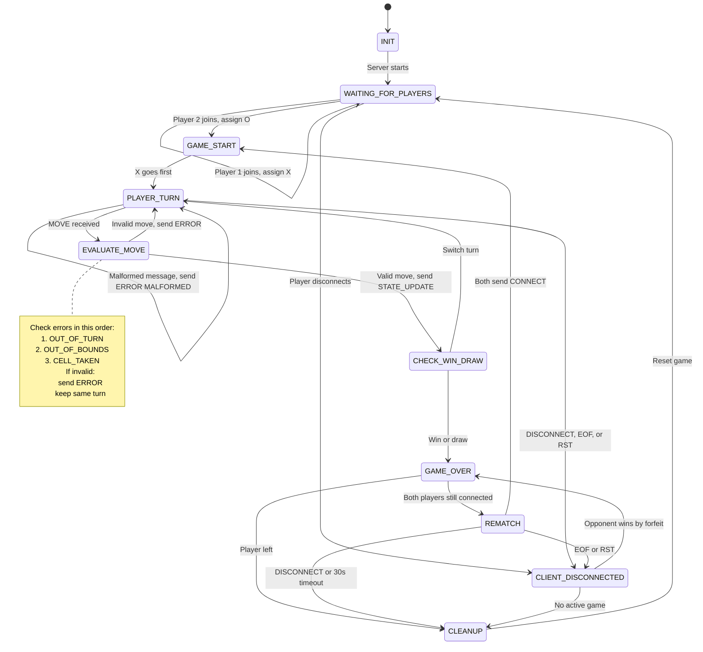

# Game State Machine

## State Diagram

This FSM controls the server-side flow for the 2-player Tic-Tac-Toe.

## State Flow

- `INIT` - Server starts and begins listening.
- `WAITING_FOR_PLAYERS` - Waits for both players to join.
- `GAME_START` - Sets up the board and starts the game.
- `PLAYER_TURN` - Waits for the active player to send a move.
- `EVALUATE_MOVE` - Checks if the move is valid.
- `CHECK_WIN_DRAW` - Checks if the game was won or ended in a draw.
- `GAME_OVER` - Ends the current game and offers a rematch.
- `REMATCH` - Waits 30 seconds, Player accepts by sending `CONNECT` and declines by sending `DISCONNECT`TCP FIN. If both accept, the board resets and a new `GAME_START` is sent.
- `CLIENT_DISCONNECTED` - Handles a player leaving or losing connection.
- `CLEANUP` - Clears the game session and gets ready for another game.

## Move Validation

Moves are checked in this order:

1. `OUT_OF_TURN`
2. `OUT_OF_BOUNDS`
3. `CELL_TAKEN`

If a move is invalid, the server sends an `ERROR` message and the same player keeps their turn.

If a move is valid, the board is updated and the server checks for a win or draw.

## Malformed Messages

If a message is not valid JSON, is missing a field, or has an unknown `msg_type`, the server sends `ERROR` with code `MALFORMED` and stays in the same state. The server never crashes on bad input.

## Disconnect Handling

A player can leave gracefully by sending `DISCONNECT`. If `recv()` returns `b""`, the server also treats it as a disconnect.

The server also handles socket errors such as:

- `ConnectionResetError`
- `BrokenPipeError`
- `ConnectionAbortedError`

If a player disconnects during a game, the other player wins by forfeit. If there is no active game, the server moves to cleanup.
