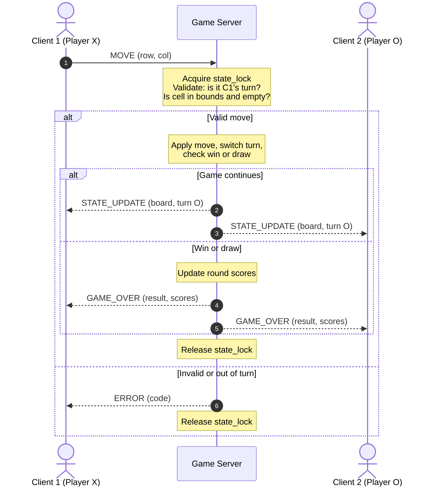

# State Synchronization & Mermaid Sequence Diagram

Round trip when Player 1 makes a move: the client sends `MOVE`, the server validates turn and legality under `state_lock`, mutates the board, and broadcasts the new state to **both** clients. The `alt`/`else` branches cover valid moves, game-ending moves with score broadcast, and invalid/out-of-turn moves returning `ERROR`.

## Flow

1. Client 1 sends `MOVE (row, col)`.
2. Server acquires `state_lock` and validates: is it Client 1's turn, and is the cell in bounds and empty?
3. **Valid, game continues:** apply the move, switch the turn, broadcast `STATE_UPDATE` to both clients.
4. **Valid, win or draw:** update scores, broadcast `GAME_OVER` (result, scores) to both clients.
5. **Invalid or out of turn:** send `ERROR` to the sender only; board and turn stay unchanged.
6. `state_lock` is released at the end, so the next move is handled cleanly.
